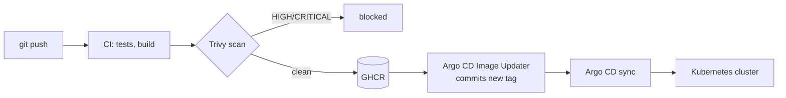

# Ferhat Saidoun

**Full-stack engineer and DevSecOps enthusiast.** I build web apps with TypeScript, Node.js and SvelteKit, then run them myself on a Kubernetes homelab, shipped through a GitOps pipeline that treats security as part of the build, not an afterthought.

*Ingénieur full-stack passionné de DevSecOps : je développe des applications et je les exploite moi-même sur mon homelab Kubernetes.*

---

## What I'm building

### A homelab run like production

- **Kubernetes on bare metal:** Proxmox on the homelab server, hosting a 3-node [Talos Linux](https://www.talos.dev/) cluster.
- **GitOps end to end:** the whole cluster is described in git. Argo CD applies it and reverts drift; Argo CD Image Updater commits every newly published image, so a merge is a deployment.
- **Secrets never leave git unencrypted:** SOPS + age files, decrypted inside the cluster by Argo CD. CI pipelines hold no deployment secret, only the default `GITHUB_TOKEN`.
- **Resilient data:** PostgreSQL via CloudNativePG (replicated, automatic failover), continuous WAL archiving and nightly base backups to S3-compatible storage (Garage on TrueNAS).
- **Single sign-on:** Keycloak with a custom theme built with Keycloakify, in front of the apps and the cluster tooling.
- **Edge and observability:** Traefik with Gateway API routes, cert-manager for TLS, VictoriaMetrics + Grafana, and alerts pushed to my phone through ntfy.

### A hardened CI supply chain

- **Trivy everywhere:** the image is scanned in the job that builds it, and fixable HIGH/CRITICAL findings block the publish. Dependencies are scanned on every push, and the published image is re-scanned every night.
- **Pinned, not trusted:** GitHub Actions pinned by commit SHA, base images by digest, tools by version + SHA256 with their Sigstore signature checked.
- **Updates under control:** weekly grouped Dependabot updates, Node.js LTS across all projects.

## Featured projects

These run in production on the homelab. Their source repositories are private; I'm happy to walk through them.

| Project | What it does | Stack |
|---|---|---|
| [**ferhatsn.fr**](https://ferhatsn.fr) | My portfolio, with an admin area behind SSO | SvelteKit, Drizzle, PostgreSQL, S3 |
| [**Radar Logement**](https://appart-rennes.ferhatsn.fr) | Watches student housing listings (Crous, Fac-Habitat, ARPEJ) and sends email alerts | NestJS, SvelteKit, BullMQ, Redis, PostgreSQL |
| [**Magic Bakery**](https://magic-bakery.com) | Website for an artisan pastry business | SvelteKit, Drizzle, PostgreSQL, S3 |
| [**auth.ferhatsn.fr**](https://auth.ferhatsn.fr) | Identity provider for all of the above | Keycloak, Keycloakify |
| **Vigie** *(paused)* | DevSecOps tool: container image inventory and Trivy vulnerability scans, rendered as a 3D harbour scene. Being rebuilt for Kubernetes | NestJS, SvelteKit, Three.js, BullMQ |

<b>Earlier work (public repositories)</b>

- [blind_maze_echo_location](https://github.com/ferhatte10/blind_maze_echo_location): 2D maze game played by sound only (C, SDL2, OpenAL)
- [Seam_Carving](https://github.com/ferhatte10/Seam_Carving): content-aware image resizing (Java)
- [Anonymous-Broadcast-Channel](https://github.com/ferhatte10/Anonymous-Broadcast-Channel): secret generation over an anonymous broadcast channel, cryptography coursework (Jupyter)
- [redeemers-web-react](https://github.com/ferhatte10/redeemers-web-react): video player with interactive chapters, map and live comments, team project (React)

## Stack

| | |
|---|---|
| **Infrastructure** | Proxmox, Talos Linux, Kubernetes, Argo CD, Helm, Kustomize, Traefik, MetalLB, cert-manager, CloudNativePG, TrueNAS, Docker |
| **Security** | Trivy, Dependabot, SOPS + age, Sigstore cosign, Keycloak (OIDC / SSO), oauth2-proxy |
| **Observability** | VictoriaMetrics, Grafana, Alertmanager, ntfy |
| **Development** | TypeScript, Node.js, NestJS, SvelteKit, Drizzle, PostgreSQL, Redis / BullMQ, Python, Vue / Nuxt, React / Next.js |

## Contact

Open to discussing DevSecOps, Kubernetes and platform work: [ferhatsnpro@gmail.com](mailto:ferhatsnpro@gmail.com) · [ferhatsn.fr](https://ferhatsn.fr) · [LinkedIn](https://www.linkedin.com/in/ferhatsdn/)
